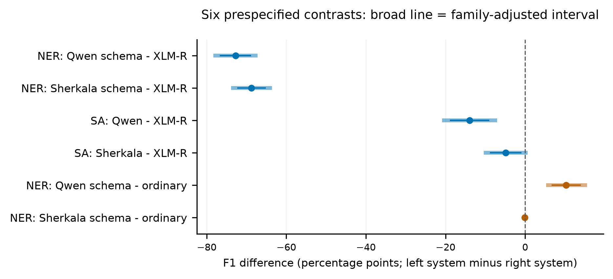

# Kazakh NLP: task quality and output reliability

Research artifact for **Task Quality and Output Reliability in Kazakh Named Entity Recognition and Sentiment Analysis**.

This project compares fine-tuned multilingual encoders with four-shot language models on **KazNERD** named entity recognition (NER) and **KazSAnDRA** binary sentiment analysis (SA). It separates task quality from two distinct output effects: constraints applied during generation and acceptance rules applied to already generated answers.

**Author:** Kartam Aruzhan, Astana IT University · **Artifact version:** 0.4.0

[Download the standalone supplement](https://github.com/aruzhanimm/kazakh-nlp-output-reliability/releases/download/v0.4.0/kazakh_nlp_supplement.zip) · [Read its two-page guide](docs/SUPPLEMENTARY_GUIDE.pdf)

## Main results

Each task uses the same fixed panel of 500 test items across systems. NER is scored by exact entity span and type; sentiment uses macro-F1 over negative and positive classes. Scores below are percentages. Encoder rows average the separate scores of seeds 13, 42 and 2026.

| System / NER output policy | NER micro-F1 | SA macro-F1 |
|---|---:|---:|
| XLM-R | 96.72 | 80.57 |
| mBERT | 96.54 | 79.39 |
| Qwen2.5-7B-Instruct, ordinary | 13.68 | 66.60 |
| Qwen2.5-7B-Instruct, JSON schema | 23.96 | — |
| Llama-3.1-Sherkala-8B-Chat, ordinary | 28.08 | 75.68 |
| Llama-3.1-Sherkala-8B-Chat, JSON schema | 27.99 | — |
| Gemma4-12B-it, strict parser | 8.16 | 77.46 |
| Gemma4-12B-it, fence-only sensitivity | 62.49 | — |
| GPT-6.1-Sol | 83.73 | 80.44 |

- Fine-tuned encoders lead exact-span NER. Their close sentiment score to GPT does not establish statistical equivalence; class errors reveal different trade-offs.
- The matched JSON-schema intervention improves Qwen's NER score by 10.27 points, while Sherkala's extraction score remains essentially unchanged.
- Gemma's two NER scores use the **same saved responses**. The prespecified sensitivity removes one eligible outer Markdown fence and leaves the entity content and alignment rules unchanged.



Points show paired F1 differences. Narrow intervals are pointwise; broad intervals account for the six primary comparisons. NER and sentiment retain their separate task metrics. Detailed estimates, uncertainty intervals, seed results and entity/class support are in [`analysis/data/`](analysis/data/).

## Reproduce the reported analysis

Use Python 3.12 in a separate environment. The following workflows require no model loading, GPU or API access.

### 1. Verify the distribution

```sh
python verify_manifest.py
python -m pip install -r requirements.txt
```

The manifest checks the distributed files against their SHA256 identities.

### 2. Check scores from the released evidence

```sh
python evidence/rescore.py --output ../rescored.json
```

The [`evidence/`](evidence/) package provides saved scoring records and their documented scope. Add `--bootstrap` to repeat the paired uncertainty calculation; this requires NumPy and additional CPU time. Full KazSAnDRA review texts are excluded from this distribution.

### 3. Regenerate tables and figures

```sh
python analysis/reproduce.py
```

This regenerates **10 LaTeX tables and four figure families** from the completed analysis and checks nine detailed CSV files. It writes to a fresh `analysis/regenerated/` directory and stops if that directory already exists. It does not generate new model answers or new bootstrap draws.

The analysis implementation also has 23 software checks:

```sh
python -m unittest discover -s src/research_execution_20261112/final_analysis -p "test_*.py"
```

## Find the research materials

| Directory | Contents |
|---|---|
| [`specification/`](specification/) | Actual selected encoder configurations; local model revisions; exact four-shot prompts and schema; generation, analysis and timing policies |
| [`configs/`](configs/) | Fixed test row IDs, dataset/tokenizer identities, checkpoint hashes and API templates |
| [`evidence/`](evidence/) | Released scoring evidence and independent rescoring utility |
| [`analysis/`](analysis/) | Aggregate results, CSV tables, table/figure builders and expected outputs |
| [`src/`](src/) | Training, inference, parsing and statistical-analysis implementations |
| [`docs/`](docs/) | Experimental design, source coverage and reproduction instructions |

Start with the [scientific specification](specification/README.txt), [experimental design](docs/EXPERIMENTS.md) and [source coverage guide](docs/SOURCE_COVERAGE.md). The [reproduction guide](docs/REPRODUCIBILITY.md) distinguishes regenerating analysis outputs from running models again.

## Scope and interpretation

Encoders use full task training data; prompted systems receive four training demonstrations selected with development evidence. This is a comparison of deployment choices with different supervision budgets. It does not isolate model architecture under equal annotation budgets.

The NER panel contains 578 gold entities across 23 of the dataset's 25 types. Per-type support is reported; rare and absent types do not support broad per-category conclusions. Intervals condition on the fitted models and fixed prompts. The API model is identified by its recorded alias and call date, without a verified immutable provider snapshot.

Full training or inference requires the pinned datasets, model access or selected weights, a suitable runtime and machine-specific paths. Historical source files retain their original runtime checks and path conventions. The repository is a research artifact, not a complete server backup or a one-command reconstruction of the original environment. Re-scoring released records, reproducing aggregate outputs and repeating model execution are separate operations.

## Citation

Citation metadata is provided in [`CITATION.cff`](CITATION.cff). A versioned repository citation can use:

```bibtex
@misc{kartam2026kazakh_nlp_artifact,
  author = {Kartam, Aruzhan},
  title = {Task Quality and Output Reliability in Kazakh Named Entity Recognition and Sentiment Analysis},
  year = {2026},
  howpublished = {Research artifact, version 0.4.0},
  url = {https://github.com/aruzhanimm/kazakh-nlp-output-reliability}
}
```

For a reproducible citation, identify the release or commit used alongside the version. No DOI is claimed.

## Data and licensing

Original dataset and model licenses continue to apply. The selected KazNERD evidence is attributed under its dataset terms; complete KazSAnDRA review texts and model weights are not redistributed. See [`THIRD_PARTY_NOTICES.md`](THIRD_PARTY_NOTICES.md).

No blanket open-source license has been assigned to the author's code. Repository access does not replace the applicable permission or license requirements for reuse.
